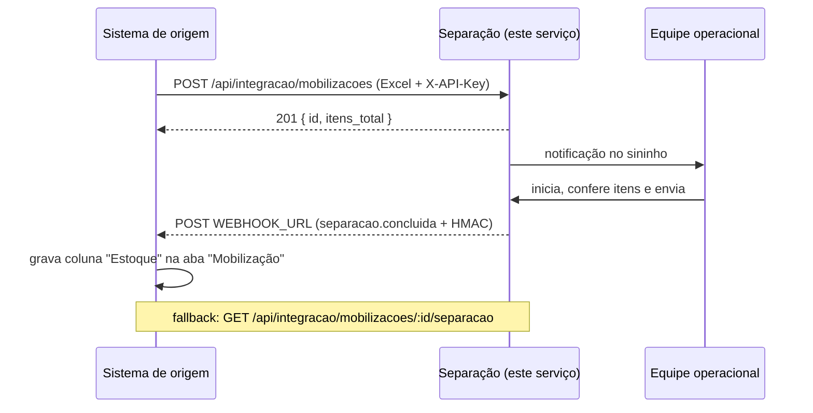

# Integração com o sistema de origem

Este documento é o **contrato completo** entre o sistema de origem (mobilizações) e este serviço (separação). Ele foi escrito para que outra LLM consiga implementar o lado de origem sem ler o código daqui.

## Visão em 30 segundos



**Contrato mínimo**

| Item | Valor |
| --- | --- |
| Base URL | definida no deploy (ex.: `https://separacao.suaempresa.com`) |
| Autenticação | header `X-API-Key: <INTEGRATION_API_KEY>` |
| IDs | `mobilizacao_id` (origem) e `separacao_id` (este serviço) |
| Upload | `multipart/form-data`, campo `arquivo` (.xlsx) |
| Retorno | webhook `POST` JSON assinado + consulta `GET` |
| Correlação dos itens | `itens[].linha` = linha real da planilha |
| Texto para a coluna Estoque | `itens[].estoque_texto` |

## 1. IDs e idempotência

### `mobilizacao_id`

- **Quem gera:** o sistema de origem, no upload. Persista o ID **antes** de chamar a API.
- **Formato:** até 64 caracteres, começando por letra/número; aceita `A-Z a-z 0-9 . _ : -`.
- **Opcional:** se omitido, este serviço gera `MOB-AAAAMMDD-XXXXXX`. Nesse caso, guarde o `id` devolvido na resposta.
- **Duplicidade:** repetir o mesmo `mobilizacao_id` devolve **409** `mobilizacao_duplicada` e não cria nada. Trate 409 como “já recebido” (veja abaixo).

### `separacao_id`

- **Quem gera:** este serviço (`SEP-AAAAMMDD-XXXXXX`).
- Aparece no webhook, na consulta e na tela. Use-o como chave única/idempotente no seu lado.

### Retry seguro do upload

Se o POST estourar por timeout, o upload pode ter sido concluído mesmo assim. O procedimento correto é:

1. repetir o POST com o **mesmo** `mobilizacao_id`;
2. se vier **409 `mobilizacao_duplicada`**, considerar sucesso;
3. opcionalmente confirmar com `GET /api/integracao/mobilizacoes/{id}`.

Não gere um ID novo no retry — isso criaria duas mobilizações iguais.

## 2. Enviar a mobilização (upload do Excel)

```http
POST /api/integracao/mobilizacoes
X-API-Key: <chave>
Content-Type: multipart/form-data
```

| Campo | Obrigatório | Descrição |
| --- | --- | --- |
| `arquivo` | sim | Arquivo `.xlsx` (ou `.xlsm`), até 10 MB por padrão |
| `mobilizacao_id` | recomendado | ID da mobilização no sistema de origem |
| `nome` | não | Nome exibido na tela; padrão = nome do arquivo |
| `obra` | não | Metadado exibido na tela |
| `solicitante` | não | Metadado exibido na tela |

```bash
curl -X POST "$BASE/api/integracao/mobilizacoes" \
  -H "X-API-Key: $INTEGRATION_API_KEY" \
  -F "arquivo=@mobilizacao.xlsx" \
  -F "mobilizacao_id=MOB-2026-000123" \
  -F "nome=Obra Norte - Lote 03" \
  -F "obra=Obra Norte" \
  -F "solicitante=Planejamento"
```

Resposta **201**:

```json
{
  "id": "MOB-2026-000123",
  "nome": "Obra Norte - Lote 03",
  "obra": "Obra Norte",
  "solicitante": "Planejamento",
  "status": "pendente",
  "arquivo_nome": "mobilizacao.xlsx",
  "itens_total": 8,
  "criada_em": "2026-11-01T17:26:23.986Z",
  "atualizada_em": "2026-11-01T17:26:23.986Z",
  "itens": [
    {
      "id": 1,
      "mobilizacao_id": "MOB-2026-000123",
      "linha": 4,
      "codigo": "EPI-001",
      "descricao": "Capacete de seguranca classe B",
      "unidade": "un",
      "quantidade_solicitada": 12,
      "observacao": "Com carneira e jugular",
      "dados_origem": "{\"Codigo\":\"EPI-001\",\"Descricao do Material\":\"Capacete de seguranca classe B\"}"
    }
  ],
  "separacao": null,
  "notificacao_id": "NTF-20261101-7KQ2M9",
  "planilha": { "aba": "Mobilização", "cabecalho_linha": 3 }
}
```

### Formato da planilha

O leitor procura, nas **10 primeiras linhas**, a primeira que tenha uma coluna de **descrição** e uma de **quantidade**. Linhas acima do cabeçalho (título, logo) são ignoradas.

| Campo interno | Cabeçalhos aceitos (sem diferenciar acento/maiúsculas) |
| --- | --- |
| `codigo` | `Codigo`, `Código`, `Cod`, `SKU`, `Codigo do Material`, `Part Number` |
| `descricao` | `Descricao`, `Descrição do Material`, `Material`, `Item`, `Nome`, `Produto` |
| `unidade` | `Unidade`, `Un`, `Unid`, `UM` |
| `quantidade` | `Quantidade`, `Qtd`, `Qtde`, `Quantidade Necessaria`, `Qtd Solicitada` |
| `observacao` | `Observacao`, `Obs`, `Comentario`, `Nota` |

Regras:

- aba preferida: nome contendo **“Mobiliza”**; senão, a primeira aba com cabeçalho válido;
- linhas em branco são ignoradas;
- `quantidade` aceita número do Excel ou texto; **vírgula é decimal** (`12,5`). Pontos de milhar em texto não são interpretados;
- quantidade ausente/inválida/negativa **rejeita o arquivo inteiro** com `422` e a lista de linhas problemáticas (nada é importado pela metade);
- itens sem código são aceitos (descrição obrigatória);
- colunas extras são preservadas em `dados_origem`, mas não usadas;
- uma coluna `Estoque` já existente é ignorada no upload.

Mais detalhes e exemplo: [`PLANILHA.md`](PLANILHA.md).

### Erros do upload

| HTTP | `codigo` | Quando |
| --- | --- | --- |
| 400 | `arquivo_ausente` | campo `arquivo` vazio |
| 400 | `arquivo_invalido` | extensão diferente de `.xlsx`/`.xlsm` |
| 400 | `id_invalido` | `mobilizacao_id` fora do formato |
| 401 | `nao_autorizado` | `X-API-Key` ausente/inválida |
| 409 | `mobilizacao_duplicada` | ID já recebido |
| 413 | `arquivo_grande` | acima de `MAX_UPLOAD_MB` |
| 422 | `planilha_invalida` | cabeçalho não encontrado ou linha inválida (`detalhes.problemas`) |

## 3. Notificação da equipe operacional

Não há nada para o sistema de origem fazer. O upload cria uma notificação interna; a tela consulta `GET /api/notificacoes/resumo` a cada 15 s e mostra o contador no sininho. Ao clicar, o operador vê a mobilização pendente.

Se quiser notificar outro canal (Telegram, e-mail), faça isso **no seu lado** após o `201`, usando o `id` retornado.

## 4. Operação (lado da separação)

1. `POST /api/mobilizacoes/{mobilizacao_id}/separacao` — abre o rascunho.
2. `PUT /api/separacoes/{separacao_id}` — autosave de cada item (`disponivel`, `quantidade_separada`, `patrimonios`).
3. `POST /api/separacoes/{separacao_id}/enviar` — valida tudo, conclui e coloca o webhook na outbox.

Regras de envio:

- todos os itens precisam estar conferidos (`disponivel` `true` ou `false`);
- item disponível exige `quantidade_separada` (0 até a solicitada);
- `operador` é obrigatório;
- enviar duas vezes é idempotente: a segunda chamada devolve **200** com `ja_enviada: true` e o mesmo payload.

## 5. Receber o retorno

### 5.1 Webhook (push)

Ao concluir, este serviço faz `POST` para `WEBHOOK_URL` com o JSON abaixo.

Headers:

| Header | Valor |
| --- | --- |
| `Content-Type` | `application/json` |
| `X-Evento` | `separacao.concluida` |
| `X-Entrega-Id` | `WHE-AAAAMMDD-XXXXXX` (um por separação, repetido em todas as tentativas — use como chave de idempotência) |
| `X-Tentativa` | `1`, `2`, … |
| `X-Assinatura` | `sha256=<hex>` — HMAC-SHA256 do **corpo bruto** com `WEBHOOK_SECRET` (omitido se o segredo não estiver configurado) |

Payload:

```json
{
  "evento": "separacao.concluida",
  "entrega_id": "WHE-20261101-HGDNEU",
  "mobilizacao_id": "MOB-2026-000123",
  "mobilizacao_nome": "Obra Norte - Lote 03",
  "obra": "Obra Norte",
  "separacao_id": "SEP-20261101-RALGA9",
  "status": "enviada",
  "operador": "Maria Silva",
  "observacao": "Material retirado do almoxarifado 2",
  "enviada_em": "2026-11-01T17:26:44.060Z",
  "resumo": {
    "itens_total": 3,
    "disponiveis": 1,
    "parciais": 1,
    "sem_estoque": 1,
    "quantidade_solicitada_total": 46,
    "quantidade_separada_total": 32
  },
  "itens": [
    {
      "linha": 4,
      "codigo": "EPI-001",
      "descricao": "Capacete de seguranca classe B",
      "unidade": "un",
      "quantidade_solicitada": 12,
      "disponivel": true,
      "quantidade_separada": 12,
      "patrimonios": [],
      "observacao": null,
      "estoque_texto": "Disponível (12/12 un)"
    },
    {
      "linha": 5,
      "codigo": "EPI-002",
      "descricao": "Luva de vaqueta reforcada",
      "unidade": "par",
      "quantidade_solicitada": 24,
      "disponivel": true,
      "quantidade_separada": 20,
      "patrimonios": ["PAT-1234", "PAT-5678"],
      "observacao": null,
      "estoque_texto": "Parcial (20/24 par) - PAT: PAT-1234, PAT-5678"
    },
    {
      "linha": 6,
      "codigo": "EPC-010",
      "descricao": "Cone de sinalizacao",
      "unidade": "un",
      "quantidade_solicitada": 10,
      "disponivel": false,
      "quantidade_separada": 0,
      "patrimonios": [],
      "observacao": "Estoque zerado",
      "estoque_texto": "Sem estoque"
    }
  ]
}
```

### 5.2 Como responder ao webhook

- Responda **2xx** em menos de 10 s. Se precisar processar algo lento, enfileire e responda já.
- O corpo da resposta é ignorado.
- Não responda 2xx antes de gravar o payload (ou de enfileirá-lo de forma durável).
- **Idempotência:** o mesmo `separacao_id` pode chegar mais de uma vez (retry ou reprocessamento manual). Faça *upsert* por `separacao_id`; use `entrega_id` + `X-Tentativa` apenas para deduplicar a mesma tentativa.
- O webhook é **congelado** no envio: representa exatamente o que o operador confirmou.

Retentativas: 1 min, 5 min, 15 min, 1 h, 6 h, 12 h, 24 h (8 tentativas). Depois disso a entrega fica `falhou` e pode ser recolocada na fila com `POST /api/integracao/webhooks/reprocessar` (exige `X-API-Key`).

### 5.3 Validar a assinatura

Node.js:

```js
import { createHmac, timingSafeEqual } from 'node:crypto';

function assinaturaValida(corpoBruto, header, segredo) {
  const esperada = `sha256=${createHmac('sha256', segredo).update(corpoBruto).digest('hex')}`;
  const a = Buffer.from(esperada);
  const b = Buffer.from(String(header ?? ''));
  return a.length === b.length && timingSafeEqual(a, b);
}
```

Python:

```python
import hmac, hashlib

def assinatura_valida(corpo_bruto: bytes, header: str, segredo: str) -> bool:
    esperada = "sha256=" + hmac.new(segredo.encode(), corpo_bruto, hashlib.sha256).hexdigest()
    return hmac.compare_digest(esperada, header or "")
```

> Use o **corpo bruto** (bytes), não o JSON reserializado. Em Express, capture com `express.raw({ type: 'application/json' })` ou guarde o `rawBody` antes do `express.json()`.

Exemplo completo e executável: [`examples/receptor-webhook.mjs`](../examples/receptor-webhook.mjs).

### 5.4 Consulta (pull) — fallback e reconciliação

Se o webhook não estiver configurado, falhar ou você precisar reconciliar:

```http
GET /api/integracao/mobilizacoes/{mobilizacao_id}/separacao
X-API-Key: <chave>
```

- **200** com o mesmo payload do webhook (mais `concluida` e `consultado_em`).
- **404 `separacao_nao_iniciada`** enquanto o operador não abriu a separação.
- Enquanto for rascunho, `concluida: false` e os campos não conferidos vêm `null`; **só grave a coluna Estoque quando `concluida: true`** (ou `status: "enviada"`).

Status da mobilização:

```http
GET /api/integracao/mobilizacoes/{mobilizacao_id}
```

```json
{
  "mobilizacao_id": "MOB-2026-000123",
  "nome": "Obra Norte - Lote 03",
  "status": "concluida",
  "itens_total": 3,
  "criada_em": "2026-11-01T17:26:23.986Z",
  "atualizada_em": "2026-11-01T17:26:44.060Z",
  "separacao": {
    "separacao_id": "SEP-20261101-RALGA9",
    "status": "enviada",
    "operador": "Maria Silva",
    "enviada_em": "2026-11-01T17:26:44.060Z"
  }
}
```

## 6. Preencher a coluna "Estoque" na aba "Mobilização"

O vínculo é a **linha da planilha**:

```text
payload.itens[i].linha  →  worksheet.getRow(linha).getCell(colunaEstoque)
```

Regras:

1. Localize a aba `Mobilização` (o nome pode variar; use a mesma aba do upload).
2. Localize a coluna `Estoque` no cabeçalho. Se não existir, crie após a última coluna do cabeçalho.
3. Para cada item do payload, escreva `estoque_texto` na linha `item.linha`.
4. **Nunca reordene as linhas** antes de gravar. Se a planilha original mudou (linhas inseridas/removidas), reconcilie por `codigo` apenas quando ele for único; caso contrário, peça nova conferência.
5. Grave apenas quando `concluida: true`. Reenviar o mesmo payload deve sobrescrever o mesmo texto (idempotente).

Exemplos de texto gerados:

| `disponivel` | `quantidade_separada` | `estoque_texto` |
| --- | --- | --- |
| `true` | 12 de 12 | `Disponível (12/12 un)` |
| `true` | 5 de 24 | `Parcial (5/24 par) - PAT: PAT-A` |
| `false` | 0 | `Sem estoque` |

Se preferir montar o texto no seu lado, use os campos estruturados (`disponivel`, `quantidade_separada`, `patrimonios`, `unidade`). O `estoque_texto` é só conveniência.

Implementação de referência (ExcelJS, mesma lib deste repo): [`examples/preencher-coluna-estoque.mjs`](../examples/preencher-coluna-estoque.mjs).

## 7. Tabela de erros

| `codigo` | HTTP | Significado |
| --- | --- | --- |
| `nao_autorizado` | 401 | `X-API-Key` ausente/inválida |
| `mobilizacao_duplicada` | 409 | `mobilizacao_id` já existe |
| `mobilizacao_indisponivel` | 409 | mobilização concluída/cancelada não pode ser separada |
| `separacao_ja_enviada` | 409 | tentativa de alterar separação enviada |
| `separacao_nao_iniciada` | 404 | operador ainda não abriu a separação |
| `nao_encontrado` | 404 | mobilização/separação inexistente |
| `planilha_invalida` | 422 | layout ou linhas inválidas (`detalhes.problemas`) |
| `conferencia_incompleta` | 422 | faltam itens conferidos (`detalhes.itens_pendentes`) |
| `quantidade_obrigatoria` | 422 | item disponível sem quantidade |
| `quantidade_acima_do_solicitado` | 422 | quantidade maior que a solicitada |
| `operador_obrigatorio` | 422 | envio sem nome do operador |
| `arquivo_invalido` | 400 | extensão/arquivo incorreto |
| `arquivo_grande` | 413 | acima do limite |
| `erro_interno` | 500 | falha inesperada (registrada no log) |

## 8. Checklist para a LLM que vai implementar o lado de origem

- [ ] Ler `INTEGRATION_API_KEY`, `WEBHOOK_URL` e `WEBHOOK_SECRET` da configuração do deploy.
- [ ] Gerar/persistir `mobilizacao_id` **antes** do upload.
- [ ] Enviar o `.xlsx` no campo multipart `arquivo`, com `X-API-Key`.
- [ ] Tratar `409 mobilizacao_duplicada` como sucesso no retry.
- [ ] Criar um endpoint de webhook que:
  - [ ] lê o corpo **bruto**;
  - [ ] valida `X-Assinatura` com HMAC-SHA256 e comparação em tempo constante;
  - [ ] responde 2xx rápido e enfileira o processamento;
  - [ ] faz upsert por `separacao_id` (idempotente).
- [ ] Gravar a coluna `Estoque` por `itens[].linha` na aba `Mobilização`, usando `estoque_texto`.
- [ ] Nunca gravar enquanto `concluida: false`.
- [ ] Ter um job de reconciliação usando `GET /api/integracao/mobilizacoes/{id}/separacao` (caso o webhook se perca).
- [ ] Recolocar entregas falhas na fila com `POST /api/integracao/webhooks/reprocessar` quando necessário.
- [ ] Não usar nome/descrição como chave; use IDs e `linha`.
- [ ] Guardar `entrega_id` e `separacao_id` para auditoria.

## 9. Testando localmente

```bash
# 1. suba este serviço
cp .env.example .env
npm install && npm start

# 2. em outro terminal, receba o webhook
WEBHOOK_SECRET=segredo node examples/receptor-webhook.mjs
# -> ouvindo em http://localhost:4000/webhook

# 3. configure e reinicie o serviço com:
#    WEBHOOK_URL=http://localhost:4000/webhook
#    WEBHOOK_SECRET=segredo

# 4. crie uma mobilização de exemplo
npm run seed

# 5. abra a tela, conclua a separação e veja o webhook chegar
```

Para simular só o upload:

```bash
curl -X POST http://localhost:3000/api/integracao/mobilizacoes \
  -H "X-API-Key: dev-key-change-me" \
  -F "arquivo=@data/exemplo-mobilizacao.xlsx" \
  -F "mobilizacao_id=MOB-TESTE-001"
```

Contrato legível por máquina: [`openapi.yaml`](openapi.yaml) e [`schemas/separacao-concluida.schema.json`](schemas/separacao-concluida.schema.json).
