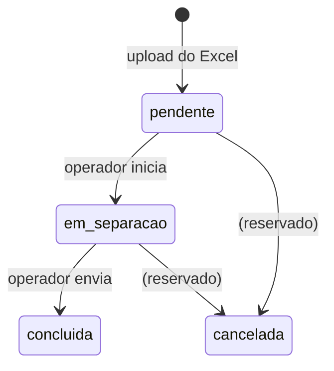

# Modelo de dados

Banco: SQLite (`db/schema.sql`, aplicado na inicialização de forma idempotente).
Datas em ISO 8601 UTC (`2026-11-01T17:26:23.986Z`). Quantidades em `REAL` para aceitar frações (ex.: 2,5 kg).

```mermaid
erDiagram
  MOBILIZACOES ||--o{ MOBILIZACAO_ITENS : "tem"
  MOBILIZACOES ||--o| SEPARACOES : "gera no máximo uma"
  MOBILIZACOES ||--o{ NOTIFICACOES : "avisa"
  SEPARACOES ||--o{ SEPARACAO_ITENS : "confere"
  MOBILIZACAO_ITENS ||--o{ SEPARACAO_ITENS : "é conferido em"
  SEPARACOES ||--o{ WEBHOOK_ENTREGAS : "retorna ao origem"

  MOBILIZACOES {
    text id PK "ID do sistema de origem"
    text nome
    text obra
    text solicitante
    text status "pendente|em_separacao|concluida|cancelada"
    text arquivo_nome
    text arquivo_caminho
    integer itens_total
    text criada_em
    text atualizada_em
  }
  MOBILIZACAO_ITENS {
    integer id PK
    text mobilizacao_id FK
    integer linha "linha real do Excel"
    text codigo
    text descricao
    text unidade
    real quantidade_solicitada
    text observacao
    text dados_origem "JSON da linha original"
  }
  SEPARACOES {
    text id PK "SEP-AAAAMMDD-XXXXXX"
    text mobilizacao_id FK "único"
    text operador
    text status "rascunho|enviada"
    text observacao
    text criada_em
    text atualizada_em
    text enviada_em
  }
  SEPARACAO_ITENS {
    integer id PK
    text separacao_id FK
    integer mobilizacao_item_id FK
    integer disponivel "NULL=não conferido, 0=não, 1=sim"
    real quantidade_separada
    text patrimonios "lista separada por vírgula"
    text observacao
  }
  NOTIFICACOES {
    text id PK
    text mobilizacao_id FK
    text tipo "mobilizacao_pendente"
    text titulo
    text mensagem
    text lida_em "NULL=não lida"
    text criada_em
  }
  WEBHOOK_ENTREGAS {
    text id PK "WHE-AAAAMMDD-XXXXXX"
    text separacao_id FK
    text evento "separacao.concluida"
    text payload "JSON enviado"
    text status "pendente|enviado|falhou"
    integer tentativas
    text proxima_tentativa_em
    text ultimo_erro
    integer resposta_status
    text criada_em
    text enviada_em
  }
```

## Tabelas

### `mobilizacoes`

| Coluna | Regra |
| --- | --- |
| `id` | Chave primária. **Vem do sistema de origem** (até 64 chars: letras, números, `.`, `-`, `_`, `:`). Se não for enviado, o serviço gera `MOB-AAAAMMDD-XXXXXX`. |
| `nome` | Obrigatório. Se vazio, usa o nome do arquivo. |
| `obra`, `solicitante` | Opcionais, metadados para a tela. |
| `status` | `pendente` → `em_separacao` → `concluida`; `cancelada` reservado. |
| `arquivo_nome`, `arquivo_caminho` | Auditoria do Excel recebido. |
| `itens_total` | Denormalizado para a lista. |

### `mobilizacao_itens`

Uma linha por material do Excel. `linha` é a **linha real da planilha** (1-based, incluindo cabeçalho) e é a chave de correspondência com a coluna "Estoque" do sistema de origem. `dados_origem` guarda a linha original em JSON para auditoria e para remapear colunas no futuro.

### `separacoes`

Uma por mobilização (`UNIQUE (mobilizacao_id)`). Criada como `rascunho` quando o operador clica em **Iniciar separação**; vira `enviada` no envio. `operador` é obrigatório para enviar (validado no servidor). `enviada_em` só existe depois do envio.

### `separacao_itens`

Conferência item a item, criada em branco junto com a separação:

- `disponivel = NULL`: ainda não conferido (bloqueia o envio);
- `disponivel = 0`: não tem em estoque (quantidade forçada a 0 e patrimônios limpos);
- `disponivel = 1`: tem em estoque; `quantidade_separada` entre 0 e `quantidade_solicitada` (pode ser parcial).

### `notificacoes`

Criada na mesma transação do upload, uma por mobilização. O sininho consulta `GET /api/notificacoes/resumo` a cada 15 s. `lida_em` nulo = não lida.

### `webhook_entregas` (outbox)

Garante o retorno mesmo com o sistema de origem fora do ar:

- o payload é **congelado** no envio (o que o operador confirmou é o que será entregue);
- worker tenta a cada 30 s, com backoff de 1 min, 5 min, 15 min, 1 h, 6 h, 12 h, 24 h;
- após 8 tentativas, `status = falhou`; `POST /api/integracao/webhooks/reprocessar` recoloca na fila;
- `GET /api/integracao/mobilizacoes/:id/separacao` continua disponível como *pull* independentemente do webhook.

## Transições de status

`separacoes.status`: `rascunho` → `enviada` (irreversível).

## Regras de quantidade

- `quantidade_solicitada >= 0`.
- `disponivel = true` exige `quantidade_separada` preenchida, `0 <= quantidade_separada <= quantidade_solicitada`.
- `disponivel = false` grava `quantidade_separada = 0` e `patrimonios = NULL`.
- `patrimonios` é texto livre normalizado para lista separada por vírgula; a API devolve array.

## Texto da coluna "Estoque"

Gerado no retorno (`estoque_texto`), com 3 formatos:

| Situação | Exemplo |
| --- | --- |
| Completo | `Disponível (12/12 un)` |
| Parcial | `Parcial (5/24 par) - PAT: PAT-A, PAT-B` |
| Sem estoque | `Sem estoque` |

O sistema de origem pode usar o texto pronto **ou** os campos estruturados. Os dois vão no mesmo payload.
